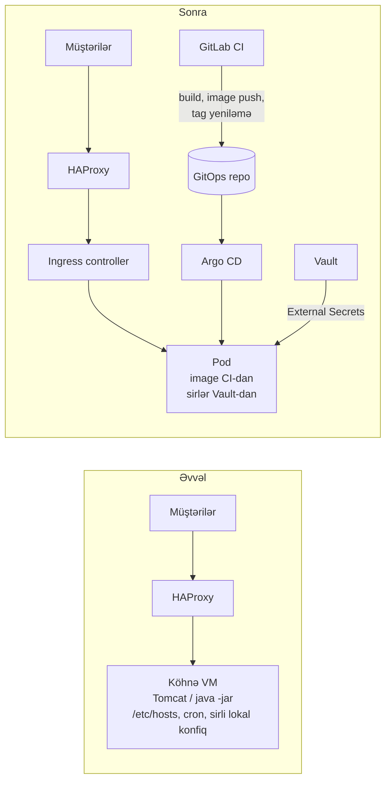

[English](README.md) | **Azərbaycanca**

# VM → Kubernetes köçürməsi: qarşılaşdığım 5 problem və onları necə həll etdim

Java inteqrasiya servislərini (Spring Boot və Tomcat/WAR tətbiqləri) uzun illər işləyən Linux
VM-lərdən Kubernetes-ə köçürərkən əldə etdiyim real təcrübə. Köçürmədə **GitLab CI**, **Argo CD**,
**HashiCorp Vault** və girişdə **HAProxy** istifadə olunub. Müştəri tərəfində heç nə dəyişməyib.

Aşağıdakı problemlərin hər biri *VM-də qüsursuz işləyirdi*, amma tətbiq pod-da işə düşəndə ya səssizcə,
ya da açıq xəta ilə sındı. Hər yazı eyni quruluşdadır: **əlamət → kök səbəb → həll → problemi daha erkən necə tutmaq**.

> Bu repodakı bütün host adları, IP-lər və servis adları ümumi nümunələrdir. Heç bir daxili məlumat yoxdur.

---

## Əvvəl və sonra



Müştərilər əvvəlki host adına müraciət etməyə davam edir. Yalnız HAProxy backend-indəki `server`
sətri dəyişir, ona görə həm keçid, həm də geri qaytarma bir sətirlik dəyişiklikdir.

---

## 5 problem

| # | Problem | Nə sındı | Həll |
|---|---------|----------|------|
| 1 | [Sirlər konfiq fayllarında idi](docs/az/01-konfiqdeki-sirler.md) | Parollar image-ə və ya repoya düşürdü | `${PLACEHOLDER}` + Vault + External Secrets Operator |
| 2 | [Gizli `/etc/hosts` asılılıqları](docs/az/02-gizli-host-asililiqlari.md) | `UnknownHostException` yalnız pod-da | Aşkarla → `hostAliases` (müvəqqəti) → DNS (daimi) |
| 3 | [Scheduled job-lar iki dəfə işlədi](docs/az/03-tekrarlanan-scheduled-joblar.md) | Köhnə VM və yeni pod eyni bazaya yazdı | Tək yazıcı ilə keçid, `replicas: 1`, `Recreate`, ShedLock |
| 4 | [Host header və ingress routing](docs/az/04-host-header-kecid.md) | HAProxy dəyişəndən sonra ingress 404 verdi | Ingress host = müştərinin istifadə etdiyi ad, `Host`-u dəyişmə |
| 5 | [İnternetsiz şəbəkədə build](docs/az/05-internetsiz-build.md) | Runner-lər Docker Hub / Maven Central-a çata bilmir | Nexus proxy, `settings.xml` mirror, sabitlənmiş base image-lər |

**Bonus:** hər servis üçün işlətdiyim [köçürmə checklist-i](docs/az/kocurme-checklist.md) və bu
problemlərin çoxunu köçürmədən *əvvəl* tapan, heç nəyi dəyişməyən [VM discovery skripti](scripts/vm-discovery.sh).

---

## Repo quruluşu

```
.
├── docs/                      # hər problem üçün ayrıca yazı + checklist (EN)
│   └── az/                    # Azərbaycanca tərcümə
├── scripts/
│   └── vm-discovery.sh        # köhnə VM-in read-only inventarı
└── examples/
    ├── k8s/                   # Deployment, Service, Ingress, ExternalSecret
    ├── argocd/                # Argo CD Application
    ├── gitlab-ci/             # pipeline + internetsiz runner üçün Maven mirror
    └── haproxy/               # backend keçidi və geri qaytarma
```

## Sürətli başlanğıc

Discovery skriptini köhnə VM-də işə sal. Skript heç nəyi dəyişmir, tam nəticə üçün root lazımdır:

```bash
sudo ./scripts/vm-discovery.sh /tmp/discovery-$(hostname)
```

Nümunə manifest-ləri [kubeconform](https://github.com/yannh/kubeconform) ilə oflayn yoxla:

```bash
kubeconform -summary -ignore-missing-schemas examples/k8s/ examples/argocd/
```

## Texnologiyalar

RHEL / Ubuntu · Java (Spring Boot, Tomcat) · Docker · Kubernetes · ingress-nginx · Argo CD ·
HashiCorp Vault · External Secrets Operator · GitLab CI · Nexus · HAProxy

## Müəllif

**Hüseyn Məmmədov**, Linux/DevOps Engineer, RHCSA.
[LinkedIn](https://www.linkedin.com/in/huseynmemmedov/) · [Credly](https://www.credly.com/users/hsmammadov/)

## Lisenziya

MIT
