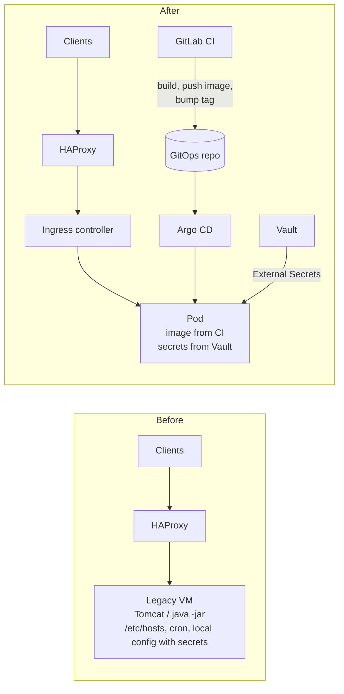

**English** | [Azərbaycanca](README.az.md)

# VM → Kubernetes Migration: 5 Problems I Hit (and How I Fixed Them)

Real-world lessons from moving Java integration services (Spring Boot and Tomcat/WAR apps) from
long-lived Linux VMs to Kubernetes with **GitLab CI**, **Argo CD**, **HashiCorp Vault** and an
**HAProxy** front door — without changing anything on the client side.

Each problem below is something that *worked fine on the VM* and broke, silently or loudly, once the
app ran in a pod. Every write-up follows the same shape: **symptom → root cause → fix → how to catch it earlier**.

> All hostnames, IPs and service names in this repo are generic examples. No internal data is included.

---

## Before and after



Clients keep calling the same hostname. Only the HAProxy backend `server` line changes, so the
cutover and the rollback are both a one-line change.

---

## The 5 problems

| # | Problem | What broke | Fix |
|---|---------|-----------|-----|
| 1 | [Secrets lived in config files](docs/01-secrets-in-config-files.md) | Passwords baked into images or repo | `${PLACEHOLDER}` + Vault + External Secrets Operator |
| 2 | [Hidden `/etc/hosts` dependencies](docs/02-hidden-host-dependencies.md) | `UnknownHostException` only in the pod | Discover → `hostAliases` (short term) → DNS (long term) |
| 3 | [Scheduled jobs ran twice](docs/03-duplicate-scheduled-jobs.md) | Old VM and new pod both wrote to the DB | Single-writer cutover, `replicas: 1`, `Recreate`, ShedLock |
| 4 | [Host header and ingress routing](docs/04-host-header-cutover.md) | 404 from ingress after switching HAProxy | Ingress host = client-facing name, never rewrite `Host` |
| 5 | [Builds in an air-gapped network](docs/05-air-gapped-builds.md) | Runners can't reach Docker Hub / Maven Central | Nexus proxies, `settings.xml` mirror, pinned base images |

**Bonus:** [the migration checklist](docs/migration-checklist.md) I now run for every service, and a
read-only [VM discovery script](scripts/vm-discovery.sh) that finds most of these problems
*before* migration.

---

## Repository layout

```
.
├── docs/                      # one write-up per problem + checklist
├── scripts/
│   └── vm-discovery.sh        # read-only inventory of a legacy VM
└── examples/
    ├── k8s/                   # Deployment, Service, Ingress, ExternalSecret
    ├── argocd/                # Argo CD Application
    ├── gitlab-ci/             # pipeline + Maven mirror settings for offline runners
    └── haproxy/               # backend cutover and rollback
```

## Quick start

Run the discovery script on a legacy VM (read-only, needs root for full results):

```bash
sudo ./scripts/vm-discovery.sh /tmp/discovery-$(hostname)
```

Validate the example manifests offline with [kubeconform](https://github.com/yannh/kubeconform):

```bash
kubeconform -summary -ignore-missing-schemas examples/k8s/ examples/argocd/
```

## Stack

RHEL / Ubuntu · Java (Spring Boot, Tomcat) · Docker · Kubernetes · ingress-nginx · Argo CD ·
HashiCorp Vault · External Secrets Operator · GitLab CI · Nexus · HAProxy

## Author

**Huseyn Mammadov**, Linux/DevOps Engineer, RHCSA.
[LinkedIn](https://www.linkedin.com/in/huseynmemmedov/)

## License

MIT
